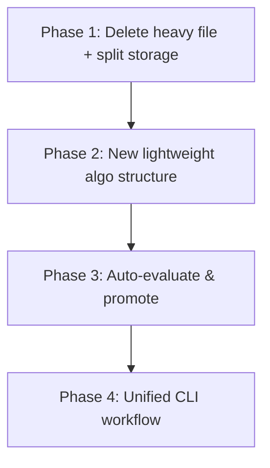

# AlgoTester Refactoring Plan

> **Goal:** Make the project lightweight, auto-promote winning versions, and simplify the structure from simple → advanced.

---

## Problem Analysis

| Problem | Root Cause |
|---|---|
| `asymmetric-multilevel-v1.json` is **3.6 MB** (96K lines) | Every backtest stores the **full tradeLog** (thousands of entries) inside the algo file |
| Opening the file freezes the editor | Single monolithic JSON per algorithm — versions + results + trade logs all in one file |
| No auto-evaluation of "is this version good?" | Manual seeding with no pass/fail gate on profit threshold |
| Multiple seed scripts (`seedAlgorithm.js`, `addVersion3.js`, `addVersion4.js`) | No unified workflow to add & evaluate versions |

---

## Plan Overview



---

## Phase 1 — Delete Heavy File & Split Storage

**What:** Separate trade logs from the algorithm definition file so algo files stay small and openable.

### Steps

1. **Delete `data/algorithms/asymmetric-multilevel-v1.json`** — the 3.6 MB bloated file
2. **Delete `data/algorithms/_index.json`** — will be recreated with new format
3. **Create new directory structure:**
   ```
   data/
   ├── algorithms/
   │   ├── _index.json              ← lightweight registry
   │   └── asymmetric-grid/
   │       ├── algo.json            ← algorithm def + version summaries (SMALL)
   │       └── results/
   │           ├── v1_run1.json     ← full backtest result with tradeLog
   │           ├── v2_run1.json
   │           └── ...
   ```
4. **`algo.json` stays tiny** — versions store config + summary metrics only, NOT trade logs
5. **`results/*.json`** — full backtest output with trade logs, read only when needed

> [!TIP]
> This means `algo.json` will be **~5-10 KB** instead of 3.6 MB. You can open it instantly.

---

## Phase 2 — New Lightweight Algorithm Structure

**What:** Redesign the algorithm JSON to match your mental model — simple, with version summaries and a promoted "best" version.

### New `algo.json` Schema

```json
{
  "name": "Asymmetric Grid",
  "code": "asymmetric-grid",
  "description": "...",
  "createdAt": "...",
  "updatedAt": "...",
  
  "bestVersion": 3,
  "promotionThreshold": {
    "minAvgTradeProfitPct": 2.0
  },

  "versionSummary": [
    {
      "version": 1,
      "tag": "v1.0-baseline",
      "status": "rejected",
      "avgTradeProfitPct": -0.5,
      "avgPerDayProfitPct": -0.02,
      "totalPnl": -8492,
      "totalTrades": 30,
      "winRatePct": 100,
      "maxDrawdownPct": 14.91,
      "promotedAt": null
    },
    {
      "version": 2,
      "tag": "v2.0-trend-gated",
      "status": "rejected",
      "avgTradeProfitPct": -0.3,
      "avgPerDayProfitPct": -0.01,
      "totalPnl": -8665,
      "totalTrades": 30,
      "winRatePct": 100,
      "maxDrawdownPct": 15.37,
      "promotedAt": null
    }
  ],

  "versions": [
    {
      "version": 1,
      "tag": "v1.0-baseline",
      "notes": "...",
      "createdAt": "...",
      "indicators": [...],
      "gridConfig": {...},
      "rules": [...],
      "ruleDesc": {
        "buy": "Rebuy at R1/R2/R3 below sell price (ATR-adaptive depths)",
        "sell": "Sell when price rises stepPct% above entry (ATR-adaptive step)"
      }
    }
  ]
}
```

### Key Design Decisions

| Field | Purpose |
|---|---|
| `bestVersion` | Points to the promoted version (null if none qualifies) |
| `promotionThreshold` | Auto-promotion gate — `minAvgTradeProfitPct: 2.0` means >2% per trade required |
| `versionSummary[]` | Quick overview of ALL versions without loading full results — **this is what you scan** |
| `versions[]` | Full config for each version — indicators, gridConfig, rules — but **NO trade logs** |
| `ruleDesc` | Human-readable buy/sell description per version |
| `status` | `"testing"` → `"promoted"` or `"rejected"` based on auto-evaluation |

> [!IMPORTANT]
> Trade logs and full backtest results live in `results/v{N}_run{M}.json` — never in `algo.json`.

---

## Phase 3 — Auto-Evaluate & Promote

**What:** After each backtest run, automatically check if the version meets the profit threshold. If yes → promote it. If no → mark as rejected.

### Logic (in `algorithm.js`)

```js
function evaluateAndPromote(algoCode, versionNum) {
  const algo = loadAlgo(algoCode);
  const summary = algo.versionSummary.find(v => v.version === versionNum);
  const threshold = algo.promotionThreshold;
  
  if (summary.avgTradeProfitPct >= threshold.minAvgTradeProfitPct) {
    summary.status = 'promoted';
    summary.promotedAt = new Date().toISOString();
    algo.bestVersion = versionNum;
    console.log(`🏆 Version ${versionNum} PROMOTED (${summary.avgTradeProfitPct}% avg trade profit)`);
  } else {
    summary.status = 'rejected';
    console.log(`❌ Version ${versionNum} rejected (${summary.avgTradeProfitPct}% < ${threshold.minAvgTradeProfitPct}% threshold)`);
  }
  
  saveAlgo(algoCode, algo);
}
```

### Auto-Promotion Flow

```mermaid
flowchart LR
    A[Run Backtest] --> B{avgTradeProfitPct >= 2%?}
    B -->|Yes| C["✅ Promote → bestVersion = N"]
    B -->|No| D["❌ Reject → keep iterating"]
    D --> E[Tweak config → create v(N+1)]
    E --> A
```

---

## Phase 4 — Unified CLI Workflow

**What:** Replace the scattered scripts (`seedAlgorithm.js`, `addVersion3.js`, `addVersion4.js`) with one unified script.

### New Commands

| Command | What it does |
|---|---|
| `npm run algo:create` | Create a new algorithm with v1 |
| `npm run algo:add` | Add a new version to an existing algorithm |
| `npm run algo:test` | Run backtest on latest version, auto-evaluate, promote/reject |
| `npm run algo:status` | Print version summary table + which version is promoted |
| `npm run algo:compare` | Side-by-side comparison of all versions |

### Single Entry Script: `scripts/algo.js`

```bash
# Create new algo with baseline version
node scripts/algo.js create --name "Asymmetric Grid" --code asymmetric-grid

# Add version 3 with tweaked params
node scripts/algo.js add --code asymmetric-grid --tag v3.0-optimized

# Run backtest + auto-evaluate
node scripts/algo.js test --code asymmetric-grid --version 3

# Check status
node scripts/algo.js status --code asymmetric-grid
```

---

## Implementation Order

### Step 1: Clean up (5 min)
- [x] Delete `asymmetric-multilevel-v1.json` (3.6 MB)
- [ ] Remove old `_index.json`
- [ ] Add `data/algorithms/*/results/` to `.gitignore` (trade logs shouldn't be in git)

### Step 2: Refactor `algorithm.js` model (30 min)
- [ ] New directory-based storage (`algo.json` + `results/` folder)
- [ ] Split `attachBacktestResult()` → save summary in `algo.json`, full result in `results/`
- [ ] Add `versionSummary[]` auto-computation (avgTradeProfitPct, avgPerDayProfitPct)
- [ ] Add `evaluateAndPromote()` function
- [ ] Add `ruleDesc` to version builder
- [ ] Keep all existing functions backward-compatible

### Step 3: Create unified `scripts/algo.js` (20 min)
- [ ] Consolidate `seedAlgorithm.js`, `addVersion3.js`, `addVersion4.js` into one script
- [ ] Subcommands: `create`, `add`, `test`, `status`, `compare`
- [ ] Auto-evaluate after every `test` run

### Step 4: Update package.json scripts (5 min)
- [ ] Add new `algo:*` npm scripts
- [ ] Keep old scripts working for backward compatibility initially

### Step 5: Update tests (15 min)
- [ ] Update `backtest.test.js` Layer 2 tests for new model
- [ ] Add test for auto-promotion logic
- [ ] Verify existing tests still pass

### Step 6: Update PROJECT_SUMMARY.md (5 min)
- [ ] Document new structure and commands

---

## What Gets Deleted

| File | Size | Reason |
|---|---|---|
| `data/algorithms/asymmetric-multilevel-v1.json` | 3.6 MB | Bloated with trade logs, slows system |
| `scripts/seedAlgorithm.js` | 11 KB | Replaced by `scripts/algo.js create` |
| `scripts/addVersion3.js` | 10.7 KB | Replaced by `scripts/algo.js add` |
| `scripts/addVersion4.js` | 10.7 KB | Replaced by `scripts/algo.js add` |

> [!NOTE]
> The old scripts won't be deleted until the new unified script is working. We'll migrate incrementally.

---

## What Stays the Same

- **`backtestEngine.js`** — No changes needed. It already returns a clean result object.
- **`dataManager.js`** — No changes needed.
- **`indicators.js`** — No changes needed.
- **`server.js`** — Minor updates later to expose algo status endpoint.
- **Test suite** — Updated but same 4-layer architecture.

---

## Summary of Benefits

| Before | After |
|---|---|
| 3.6 MB single file, freezes editor | ~5 KB `algo.json` + separate result files |
| Manual version evaluation | Auto-promote if >2% avg trade profit |
| 3 separate scripts to add versions | 1 unified `algo.js` CLI |
| No clear "best version" indicator | `bestVersion` field + `status` per version |
| Trade logs bloat the algo file | Trade logs in separate `results/` directory |
| Complex nested structure | Clean `versionSummary[]` for quick scanning |
